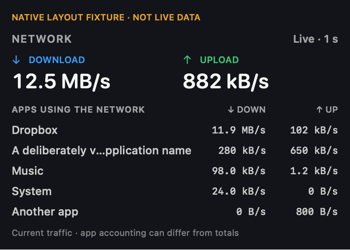
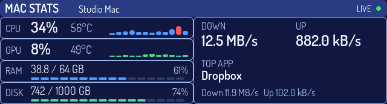

# Companion 0.3.10 (46): live network preview

Date: 2026-10-22. One macOS 14+ universal app serves ScryBar and Meguru.
This preview is intended for testing on the two physical displays. Firmware
publication is separate from Companion publication.

## Result

- Existing music menu item retained; an additional compact two-line item shows
  download/upload with byte units. Both open the same popover. Settings can hide
  the additional item without stopping collection or delivery.
- Popover: directional totals, up to five active apps ranked by combined traffic,
  each app's down/up rates, then compact CPU/GPU and RAM/disk.
- Display payload: physical network totals, leading app and its rates, Mac name,
  attribution availability, existing hardware statistics and ISO8601 timestamp.
- One collector and existing independent endpoint/feed lanes serve both displays.
  Older Meguru firmware without `mac-stats` remains compatible.
- No destinations, IPs, domains, browser tabs, URLs or packet contents collected
  by the new feature. Music-only privacy, printer Keychain identity, camera cleanup,
  public TV cover URL and negotiated HD covers remain in the same app.

See the exact [wire contract and collector notes](../mac-stats-live-v1.md).

## Evidence

| Check | Result |
| --- | --- |
| Swift suite on native macOS | 59 tests passed, including source privacy, multi-display isolation, network parser/rates/wire, camera cleanup and secure paste |
| Live collector smoke | Real interface counters and app attribution observed; stop cannot restart the collector |
| Collector CPU probe | 0.0893 CPU s / 8.63 elapsed s, about 1.04% of one core; 4.58 MB RSS; short local sample, not a whole-app benchmark |
| Native SwiftUI layout | Live/waiting/stale, five apps, long names rendered and inspected; synthetic data labelled |
| Mac runtime, build 45 | Real live rates/app ranking/popover inspected; network indicator switch tested off/on and restored on; music-only policy confirmed on. Test-launch persistence caused a user-blocking popover; the owner requested immediate termination |
| Dismissal correction, build 46 | Headless compile and universal package passed; strict signature and DMG checksum verified. Installed on disk and left stopped. Transient behavior retained even with `--open`; explicit Close and Escape in main/settings. No GUI relaunch or visual acceptance of this correction |
| Meguru M0.15.0 real feed | Headless harness using the actual Companion collectors: 20/20 HTTP POSTs accepted; 19 measured total samples, 18 fresh attributed samples, receivedMacStats=true |
| Universal release | x86_64 + arm64; strict code-signature validation; ad-hoc signature |
| DMG integrity | hdiutil checksum verified |
| ScryBar r309 | ESP32 build passed; 6,746,135-byte program; 182,096-byte static RAM; four C++ tests passed |
| ScryBar layout | Actual LVGL 8.3.11 renderer inspected at 640×172 in all seven themes and waiting/live/stale/idle/unavailable/legacy/long states |





Native rendering is separate from a live menu/popover or physical-display test.

## Build notes

Commands used:

```sh
swift test --build-system native --disable-sandbox --scratch-path /tmp/scrybar-live-native-tests
SCRYBAR_NETWORK_LIVE_SMOKE=1 swift test --build-system native --disable-sandbox \
  --scratch-path /tmp/scrybar-network-native-tests --filter 'network|nettop|appHelpers|stoppedNetwork'
SCRYBAR_SDK_STAT_CACHE_ENABLE=NO bash script/build_companion_dmg.sh
```

The Codex sandbox denied interface sysctls and the existing AppKit clipboard test;
these passed in normal native execution without sudo or a new app entitlement.
Xcode's SDK stat-cache event loop delayed builds; disabling that cache for the
invocation avoided the wait without changing global settings. No package
dependencies or lockfiles changed; scratch/derived files stayed outside Dropbox.

The installed Arduino ctags executable was Intel-only. A temporary native copy,
with the upstream SDK macro fix from [Arduino ctags PR 24](https://github.com/arduino/ctags/pull/24),
was used only for the isolated ScryBar build. No global toolchain was replaced.
Firmware candidate artifacts are under `/tmp/arduino-build-scrybar-network-r309-isolated`.

## Publication and device checkpoint

- Companion DMG prepared locally. Automatic approval review rejected source
  publication to the public `enuzzo/scrybar` repository because the user had
  authorized the app release but had not explicitly authorized source-code
  egress. No source push, public source archive or release upload occurred.
- Companion 0.3.10 is installed at `/Applications/ScryBarCompanion.app`, after
  the user quit 0.3.9 normally. The old app is preserved at
  `/Applications/.ScryBarCompanion.rollback-20261022-0.3.9.app`. Native live
  popover inspection observed real total rates, directional app rates and
  compact hardware statistics; one network collector process was running.
  The `--open` test path incorrectly made that popover application-defined.
  The user reported it could not be dismissed while working. The app was
  terminated at their urgent request, and remains stopped. Build 46 removes
  that override and adds an explicit Close/Escape action. No further visible
  test, relaunch or focus change is authorized without advance agreement.
  Build 46 replaced the installed files without launching; the previous build
  45 is preserved at `/Applications/.ScryBarCompanion.rollback-20261022-0.3.10-45.app`.
  Printer status was waiting for saved Keychain access at this checkpoint;
  no printer credentials were inspected or changed.
- ScryBar was not connected; no serial access or flash performed. The user will
  be notified when Meguru's USB work is complete and ScryBar can be connected.
- Meguru M0.15.0 was installed app-only after verified original-device identity,
  backup, exact readback and clean 45-second boot, as recorded in its repository
  at `docs/builds/meguru-m0150-installed.json`. The real collector-only harness
  confirmed delivery/parser acceptance. The owner still needs to inspect the
  actual panel; transport/readback evidence is not physical visual acceptance.
- Website deployment is separate; the website and firmware flasher are not
  redeployed by a Companion-only tag.
- No Developer ID signing/notarization identity is configured for this package;
  it uses the same ad-hoc distribution model as earlier Companion packages.
  The package script now disables Xcode signing and performs local ad-hoc signing
  explicitly, avoiding an unnecessary automatic provisioning/Keychain lookup.

Final build 46 DMG SHA256:
`531274a47d842b22a2553a7701a9f61626fa62a23750972bcbfaa7b5520de54c`.
